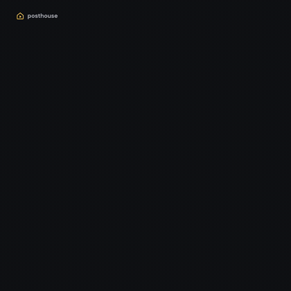
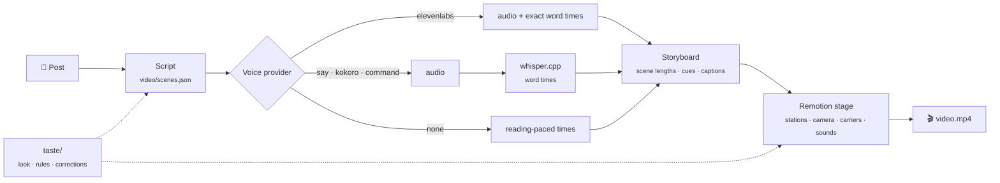

<p align="center">
  
</p>

<h1 align="center">posthouse</h1>

<p align="center">
  <b>Turn a written post into a narrated, captioned video.</b><br>
  One continuous stage. A camera that travels between ideas. Visuals that fire on the exact word that names them.
</p>

<p align="center">
  <a href="LICENSE"></a>
  
  
</p>

<p align="center">
  
  <br><sub>The example video in <code>template/</code>, made with the free macOS voice. Its source post is <a href="examples/hello-posthouse/post.md">examples/hello-posthouse/post.md</a>.</sub>
</p>

---

## What it does

You give it a post (a blog article, project write-up, notes). You get back an MP4 for LinkedIn, Shorts or YouTube.

- **Narrated.** ElevenLabs (including a clone of your own voice), a free local voice, or no voice at all.
- **Timed by the voice.** Every word gets a timestamp. A chart grows on "doubled"; a card pops on "three".
- **No slides.** Scenes are stations on one world. The camera travels between them and an element from one scene
  morphs into the next, so the video never cuts.
- **Captioned.** Burned-in captions that brighten word by word, so it works on mute.
- **Sound as haptics, music that ducks.** A soft whoosh on every move, a tick when a shape lands, a pop on a
  reveal, and a music bed that dips under the voice.
- **Assets from anywhere.** Your files, local models (ACE-Step, MusicGen, Stable Audio Open), CC0 libraries or
  ElevenLabs. Free sources first; paid ones only when you ask. Every asset records its licence.
- **Yours.** Your look and rules live in plain markdown (`taste/`). Your notes on each video become new rules.
- **Agent-ready.** Ships as a Claude Code skill (`/posthouse`). Any coding agent can follow `SKILL.md`.

## Quickstart

You need **Node 20.12+** and **ffmpeg**.

```bash
git clone https://github.com/SurajMondem/posthouse.git
cd posthouse
npm run setup            # installs Remotion into template/
npm run doctor           # checks everything and tells you how to fix what's missing
```

Render the example video:

```bash
cd template
npm run voice            # voices the 6 scenes (macOS: built-in voice; elsewhere: silent)
npm run storyboard       # timing from the voice, cues from the words, caption pages
npm run render           # → template/renders/video.mp4
```

Make your own:

```bash
node bin/posthouse.mjs new my-first-video --post path/to/your-post.md
cd videos/my-first-video
# write video/scenes.json (what the voice says, which words fire which visuals)
npm run voice && npm run storyboard
npm run studio           # live preview while you build the scenes in src/video/
node ../../bin/posthouse.mjs asset music "calm warm synth pad" --seconds 60 --name bed   # optional bed
npm run render
```

Draft for free, then polish once it's right:

```bash
npm run voice -- --final   # your ElevenLabs voice, only when you ask (cost shown first)
npm run storyboard && npm run render
```

The easy way is to let an agent direct it (see [Use with Claude Code](#use-with-claude-code)).

## How it works



1. **Script.** One scene per idea, written for the ear. Each scene names its **cues**: a cue is a word in the
   narration that fires a visual.
2. **Voice.** A provider turns each scene into audio. Scenes are cached by a hash of their text and settings, so
   changing one sentence re-voices one scene.
3. **Word timings.** ElevenLabs returns them. For local voices, whisper.cpp listens to the audio and the result is
   aligned back onto your script, so captions show your exact words. No whisper? Times are estimated.
4. **Storyboard.** Each scene lasts `0.4 s + voice + 0.6 s`. The camera moves in the pauses. Cue words become
   timestamps. Captions are paged per scene.
5. **Stage.** One React world in Remotion. Stations sit side by side; the camera rests on each while it speaks,
   then travels to the next while a carrier morphs a shape across.

Deeper: [docs/architecture.md](docs/architecture.md).

## Pick a voice

| Provider | Cost | Setup | Word timings | Best for |
|---|---|---|---|---|
| `say` | free | none (macOS only) | whisper or estimate | trying it out, drafts |
| `kokoro` | free | `node bin/posthouse.mjs setup kokoro --yes` | whisper or estimate | free, offline, good quality |
| `command` | free | any TTS CLI (Piper, XTTS…) | whisper or estimate | your own local model |
| `elevenlabs` | paid | API key in `.env` | exact, built in | the final voiceover, your own clone |
| `none` | free | none | reading pace | silent, captioned videos |

There are two voices. The **draft** voice (`voice.provider`, free) is used every time. The **final** voice
(`voice.final`, ElevenLabs) is used only with `npm run voice -- --final`. Both are cached, so switching never
pays twice. Pick yours in `posthouse.config.local.json`:

```json
{ "voice": { "provider": "kokoro", "kokoro": { "voice": "af_heart" }, "elevenlabs": { "voiceId": "…" } } }
```

Full setup for each, plus whisper.cpp: [docs/voices.md](docs/voices.md).

## Sounds and music

```bash
node bin/posthouse.mjs sources                                   # what's ready on this machine
node bin/posthouse.mjs asset music "uplifting synth, 100 bpm" --seconds 60 --name bed --video my-first-video
node bin/posthouse.mjs check --video my-first-video --commercial # licences of everything in the video
```

| Source | Makes | Cost | Licence of the output |
|---|---|---|---|
| your files (`assets/`, `library/`) | both | free | yours |
| synth / procedural (built in) | sfx / music | free | MIT |
| [ACE-Step 1.5](https://github.com/ace-step/ACE-Step-1.5) (local) | music | free | MIT |
| [MusicGen](https://github.com/facebookresearch/audiocraft) (local) | music | free | CC-BY-NC 4.0: non-commercial |
| [Stable Audio Open](https://huggingface.co/stabilityai/stable-audio-open-1.0) (local) | both | free | Stability community licence |
| [Openverse](https://openverse.org) CC0 search | both | free | CC0 |
| ElevenLabs | both | paid, **only with `--source elevenlabs`** | plan terms |

Local models install only when you ask (`node bin/posthouse.mjs setup acestep --yes`). Details:
[docs/assets.md](docs/assets.md).

## Use with Claude Code

posthouse is a [Claude Code skill](https://docs.claude.com/en/docs/claude-code/skills). Link it once:

```bash
ln -s "$(pwd)" ~/.claude/skills/posthouse
```

Then in any project:

```
/posthouse path/to/post.md
```

The agent reads the post, proposes a plan (scenes, hook options, length) and waits for your yes. Then it voices
the script, builds the scenes, checks its own frames and renders. Your feedback on the result becomes a line in
`taste/corrections.md`, after you approve it. Other agents (Codex, Cursor, …) can follow [SKILL.md](SKILL.md)
directly; [AGENTS.md](AGENTS.md) points them there.

## Make it yours

| Change | Where |
|---|---|
| Colours, fonts | `taste/look.md` + `template/src/framework/theme.ts` |
| Rules the agent follows | `taste/rules.md` |
| Corner mark | `chrome` in each video's `src/video/config.tsx` |
| Sounds, music | `posthouse asset …` or your own files ([docs/assets.md](docs/assets.md)) |
| Which sources are tried, in what order | `assets.*.order` in `posthouse.config.local.json` |
| Voice | `posthouse.config.local.json` ([docs/voices.md](docs/voices.md)) |
| Taste kept in another folder (your notes) | `"taste": "/path/to/folder"` in `posthouse.config.local.json` |

All options: [docs/configuration.md](docs/configuration.md). Building scenes: [docs/stage-api.md](docs/stage-api.md).

## Project layout

```
posthouse/
├── SKILL.md                 the director's playbook (Claude Code skill)
├── bin/posthouse.mjs        CLI: doctor · new · voices · say · asset · sources · check · setup · serve · kit · usage
├── lib/                     voice providers, asset resolver, word alignment, storyboard, sound kit
├── plugins/                 optional local models (MusicGen, Stable Audio Open), installed on request
├── template/                the Remotion project every video starts from
│   ├── src/framework/       the stage, captions, theme (shared, never per-video)
│   ├── src/video/           this video's scenes and carriers (replace per video)
│   └── video/scenes.json    this video's script and cues
├── taste/                   look, rules, corrections (edit to make it yours)
├── kit/                     sound kit + reusable scene components
├── examples/                source posts for the examples
├── docs/                    architecture, voices, assets, sound, decisions, stage API
├── library/                 your reusable sounds and tracks (git-ignored)
└── videos/                  your videos (git-ignored, never pushed)
```

## Good to know

- **Remotion's licence.** posthouse is MIT. It renders with [Remotion](https://www.remotion.dev), which is free for
  individuals and small teams but needs a company licence for larger companies. Check
  [remotion.dev/license](https://www.remotion.dev/license) before using posthouse at work.
- **Output licences.** macOS system voices and MusicGen are non-commercial. ElevenLabs' free tier needs
  attribution; paid plans allow commercial use. Kokoro and ACE-Step are permissive. `posthouse check --commercial`
  checks a whole video. Full list: [THIRD_PARTY_NOTICES.md](THIRD_PARTY_NOTICES.md).
- **Your files stay local.** `videos/`, renders, `cache/`, `library/`, `.env` and `posthouse.config.local.json` are
  git-ignored.
- **Cost.** Free by default. ElevenLabs runs only when a command asks for it (`--final`, `--source elevenlabs`),
  and `--dry-run` shows the credit cost first.

## Roadmap

- A kit of building blocks for scenes (charts, device frames, cursor, code blocks), about 20% of a video, so the
  other 80% stays creative
- Style import from an existing design system (CSS variables, Tailwind config, a website)
- Scene layouts proven for 1080×1920 (Shorts) and 1920×1080 (YouTube)
- Post / PDF / URL ingest and a one-command `make`
- An automated frame check (overlaps, off-canvas text, empty stations)

Ideas and pull requests welcome: [CONTRIBUTING.md](CONTRIBUTING.md).

## License

[MIT](LICENSE). Fonts in `template/public/fonts/` are under the [SIL Open Font License](template/public/fonts/OFL.txt).
Dependencies, optional tools and voice output terms: [THIRD_PARTY_NOTICES.md](THIRD_PARTY_NOTICES.md).
