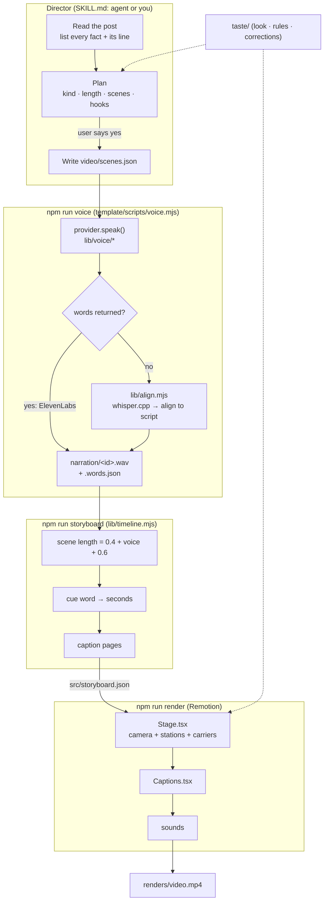
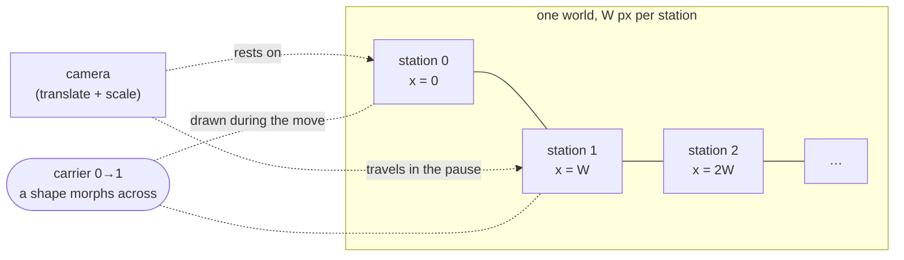

# Architecture

posthouse is three layers: a **director** (an agent following `SKILL.md`, or you), a small **Node library** that
turns text into timed audio, and a **Remotion stage** that turns timed audio into pictures.

## The pipeline



Each arrow is a file on disk, so every step can be rerun on its own and inspected.

| Step | Reads | Writes |
|---|---|---|
| `posthouse new` | `template/` | `videos/<slug>/` + `posthouse.json` (link back to the repo) |
| `npm run voice` | `video/scenes.json`, config | `narration/<id>.{wav,words.json,json}`, `public/voice/<id>.wav` |
| `npm run storyboard` | `video/scenes.json`, `narration/` | `src/storyboard.json` |
| `npm run render` | `src/`, `public/` | `renders/video.mp4` |

## The stage

The stage is the idea that makes posthouse videos feel like one shot instead of slides.



- **Stations.** Each non-overlay scene is a React component placed at `x = i × W` in one big world.
- **Camera.** A single transform on the world. It rests on a station while that scene's voice plays, then eases to
  the next in the pause (1.0 s), or pulls back (1.5 s) to show every station for the closing overlay.
- **Carriers.** While the camera travels, a carrier draws an element morphing from its box in one station to its
  box in the next (`mix(fromBox, toBox, p)`). The original fades back; the destination's copy appears on arrival.
  The eye follows the shape, so the move reads as continuous.
- **Scene clock.** Inside a scene, `useT()` gives `t` (seconds since the camera arrived; negative while it travels
  in) and `gone` (the camera has left). Cues are seconds since arrival, so `appear(t, cues.doubled)` fires exactly
  on the word.

### Timeline of one scene

```mermaid
gantt
  dateFormat X
  axisFormat %S s
  section camera
  arrives (move in)      :0, 10
  rests                  :10, 62
  travels to next        :62, 72
  section voice
  lead 0.4 s             :10, 14
  narration              :14, 56
  tail 0.6 s             :56, 62
  section sound
  pop on cue word        :milestone, 30, 30
  whoosh                 :62, 70
  tick (carrier lands)   :milestone, 72, 72
```



## The voice layer

Every provider has the same shape (`lib/voice/index.mjs`):

```js
{ name, words: 'exact' | 'aligned' | 'estimate',
  describe(opts), check(opts) → { ok, detail, fix },
  speak({ text, previousText, nextText, out, opts }) → { wav | null, words?, duration? },
  list?(opts), estimate?(texts, opts) }
```

- `exact`: the provider returns word timings (ElevenLabs, from per-character alignment).
- `aligned`: audio only. `lib/align.mjs` runs whisper.cpp, then aligns the heard words onto the script with an
  edit-distance match. The script stays the source of truth, so captions show your words with your punctuation,
  and spoken numbers ("thirty percent") still match written ones ("30%"). Words whisper missed get interpolated
  times.
- `estimate`: no audio (silent mode), or no whisper available. Words are spread by length.

Caching: each scene's audio is keyed by `sha256(provider, settings, text, neighbouring text)`. Edit one scene and
only that scene is re-voiced. Paid providers show the cost of exactly what will be generated.

## Why it's built this way

The trade-offs, and the alternatives that were considered: [decisions.md](decisions.md).
