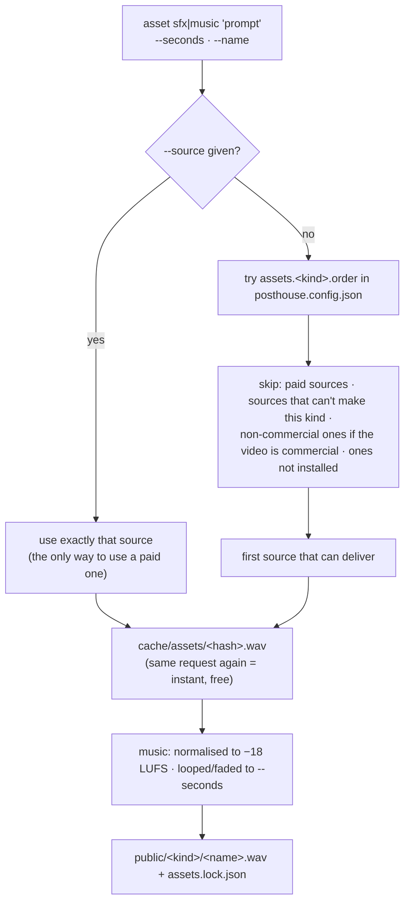

# Assets: sounds and music from anywhere

One command fetches or makes a sound or a music track for a video, from whichever source can deliver it. Every
asset is cached, written into the video's `public/` folder, and recorded with its source and licence.

```bash
cd videos/my-video
node ../../bin/posthouse.mjs asset music "calm warm synth pad" --seconds 60 --name bed
node ../../bin/posthouse.mjs asset sfx "deep cinematic whoosh" --name whoosh
node ../../bin/posthouse.mjs asset sfx "deep cinematic whoosh" --name whoosh --dry-run   # which source, and why
```

## How a source is chosen



Default order (change it in `posthouse.config.local.json`):

| Kind | Order |
|---|---|
| `sfx` | `files` → `synth` → `stable-audio` → `openverse` → (`elevenlabs`, only with `--source`) |
| `music` | `files` → `acestep` → `musicgen` → `stable-audio` → `openverse` → `procedural` → (`elevenlabs`, only with `--source`) |

`node bin/posthouse.mjs sources` shows which are ready on your machine.

## Sources

| Source | Makes | Setup | Output licence | Notes |
|---|---|---|---|---|
| `files` | both | drop files in `<video>/assets/<kind>/` or the shared `library/<kind>/` (git-ignored) | yours | matched by `--name` (or a slug of the prompt). A `<file>.license` text file next to it is recorded. |
| `synth` | sfx | none | MIT | whoosh, tick, pop, sting, riser, impact, chime, picked from words in the prompt |
| `procedural` | music | none | MIT | soft chord bed; mood from the prompt (calm, uplifting, dark, tense). Always works. |
| `acestep` | music | `setup acestep --yes`, then `serve acestep` | **MIT** | ACE-Step 1.5: full songs or instrumentals, 10–600 s. "vocals" in the prompt allows singing; otherwise instrumental. Needs ~8 GB of models and, in practice, **32 GB+ RAM or a CUDA GPU** (see below). |
| `musicgen` | music | `setup musicgen --yes` | **CC-BY-NC 4.0** | Meta MusicGen (small by default). Up to 30 s, looped to length. **Non-commercial.** |
| `stable-audio` | both | `setup stable-audio --yes` + accept the model terms on Hugging Face + `huggingface-cli login` | Stability AI Community License | Stable Audio Open 1.0: realistic foley and textures up to 47 s. Free commercial use under US$1M annual revenue. |
| `openverse` | both | none (online) | CC0 by default | Searches Openverse (mostly Freesound) for CC0 audio and records a credit line. |
| `elevenlabs` | both | `ELEVENLABS_API_KEY` | ElevenLabs plan terms | **Paid. Used only with `--source elevenlabs`.** |

## What's been tested

On an Apple M1 Pro with 16 GB of RAM (macOS, October 2026):

| Source | Result |
|---|---|
| `synth`, `procedural` | ✓ instant |
| `openverse` | ✓ CC0 sound from Freesound, licence and credit recorded |
| `musicgen` (small) | ✓ 20 s of music in ~2 min on the first run (includes the model download), on the Apple GPU (MPS) |
| `acestep` | ✗ on this machine. Diffusion worked (60–70 s for 20 s of music) but memory demand pushed macOS to swap 11+ GB to disk and the run was killed. Use a machine with 32 GB+ RAM or a CUDA GPU. posthouse refuses ACE-Step requests when less than 20 GB of disk is free, so it can't fill your drive. |
| `stable-audio` | not yet tested (gated model; needs a Hugging Face login) |
| `elevenlabs` | client unchanged from production use; not re-run for this release |

Reports from other hardware are welcome in issues.

## Paid sources are intentional

Nothing paid runs unless the command names it. Draft a video with free sources; when the draft is right, ask for
the polished version:

```bash
npm run voice -- --final                                          # narration in your ElevenLabs voice
node ../../bin/posthouse.mjs asset music "warm cinematic piano" --seconds 60 --name bed --source elevenlabs
```

Both are cached, so switching back and forth between draft and final never pays twice for the same take.

## Licences and credits

```bash
node ../../bin/posthouse.mjs check                # every voice take, sound, track and font with its licence
node ../../bin/posthouse.mjs check --commercial   # fails if anything is non-commercial (or set "commercial": true in scenes.json)
```

`check` also prints credit lines (for Openverse finds) to paste into your video description. A video marked
`"commercial": true` makes the resolver skip non-commercial sources automatically.

## Using music in a video

```json
"music": { "file": "music/bed.wav", "volume": 0.3, "duck": 0.4 }
```

in `video/scenes.json`. The bed fades in, dips to `volume × duck` under every line of narration, rises in the
pauses and fades out at the end. Because every track is normalised to −18 LUFS, `volume` means the same thing
whatever made the track.

## Adding a source

A new entry in `lib/assets/sources.mjs` with `name`, `kinds`, `license()`, `available()` and `generate()`, plus a
row here. Python models go in `plugins/<name>/` (see [plugins/README.md](../plugins/README.md)).
