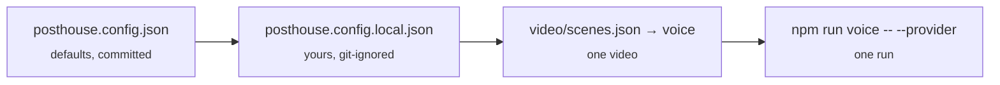

# Configuration

Three layers, each merged over the one before:



Secrets are never in any of these. They come from the environment or `.env` (git-ignored; copy `.env.example`).

## posthouse.config.json

| Key | Default | Meaning |
|---|---|---|
| `voice.provider` | `"auto"` | `elevenlabs`, `say`, `kokoro`, `command`, `none`, or `auto` (`say` on macOS, else `none`) |
| `voice.say` | `{ voice: "Samantha", rate: 180 }` | macOS voice name; words per minute |
| `voice.kokoro` | `{ voice: "af_heart", speed: 1, dtype: "q8" }` | Kokoro voice, speed, model precision |
| `voice.command` | `{ run: "", input: "stdin", ext: "wav" }` | see [voices.md](voices.md#command-any-local-tts) |
| `voice.elevenlabs` | `{ voiceId: "", modelId: "eleven_multilingual_v2", … }` | voice, model, `settings` (stability, similarity_boost, style, use_speaker_boost), output format |
| `voice.none` | `{ wordsPerSecond: 2.5 }` | reading pace for silent videos |
| `align.whisper` | `"auto"` | `auto` (find `whisper-cli` on PATH), `off`, or a path to the binary |
| `align.model` | `""` | path to a ggml model; empty = search the usual places |
| `align.language` | `"en"` | whisper language code |
| `taste` | `"taste"` | folder with `rules.md`, `look.md`, `corrections.md` (relative to the repo, or absolute) |

Example `posthouse.config.local.json`:

```json
{
  "voice": { "provider": "elevenlabs", "elevenlabs": { "voiceId": "abc123", "voiceName": "Me" } },
  "taste": "~/notes/video-taste"
}
```

## video/scenes.json

| Key | Meaning |
|---|---|
| `width`, `height`, `fps` | canvas (1080×1080 feed, 1080×1920 shorts, 1920×1080 YouTube) and frame rate |
| `scenes[].id` | unique id; also the narration file name |
| `scenes[].text` | exactly what the voice says |
| `scenes[].cues` | `{ name: "spoken word" }`. The first match of that word (numbers match as digits or words) |
| `scenes[].overlay` | `true` on the last scene draws it over a pulled-back view of every station |
| `captionPhrases` | `{ "spoken phrase": "shown form" }`, e.g. `{ "example dot com": "example.com" }` |
| `captionFixes` | `{ "heard": "shown" }` or `{ "/regex/i": "shown" }` for one-word fixes |
| `voice` | per-video voice override: `{ "provider": "…", "<provider>": { … } }` |
| `sting` | `false` to drop the closing sting |

## Environment

| Variable | Used by |
|---|---|
| `ELEVENLABS_API_KEY` | the `elevenlabs` provider |
| `ELEVENLABS_BASE_URL` | optional; a proxy or regional endpoint |
| `WHISPER_MODEL` | optional; path to a whisper.cpp ggml model |
