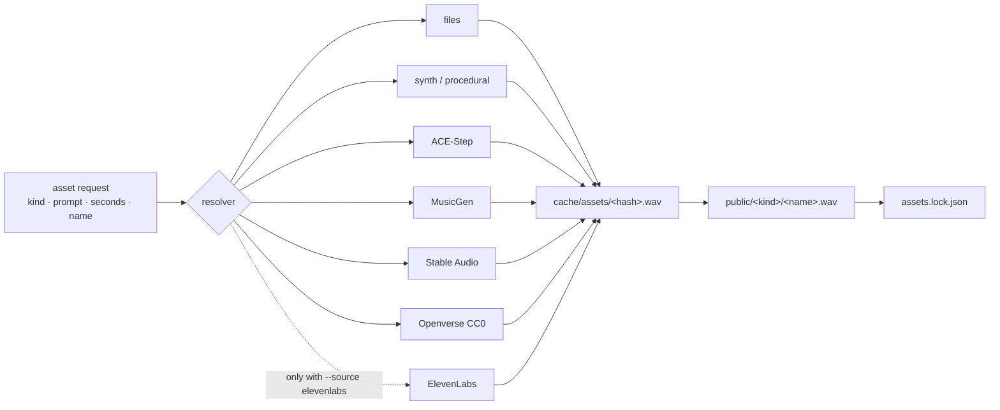

# Design: the open asset layer (v0.2)

Status: agreed 2026-10-20. Built in 0.2.0.

## Intent

Anyone should be able to make any video that code can make, in their own style, with sounds and music from
wherever they like. Drafting should cost nothing. Paid services are used only when someone asks for them.

## Decisions

1. **ElevenLabs is intentional.** It is never picked by default, by config alone, or as a fallback. It runs only
   when the command says so: `npm run voice -- --final` (or `--provider elevenlabs`) for narration, and
   `posthouse asset … --source elevenlabs` for sounds and music. Draft with free sources; spend credits on a
   version you already like.
2. **Local and free first.** For each asset kind, a resolver tries sources in a configurable order and uses the
   first that can deliver: your files → local generation → free libraries.
3. **Every source is optional and pluggable.** Heavy models (ACE-Step, MusicGen, Stable Audio Open) install only
   when asked (`posthouse setup <name>`), each in its own environment, and talk to posthouse over a process or HTTP
   boundary. `lib/` stays dependency-free.
4. **Licences travel with assets.** Every voice take and asset records its source, model and licence
   (`assets.lock.json`, `narration/*.json`). `posthouse check --commercial` flags anything not cleared for paid
   use.
5. **Nothing is generated twice.** Voice takes and assets are cached by a hash of the request, per provider, so
   switching between draft and final never re-spends credits.
6. **Open style.** No locked style packs. Each video owns its tokens and can change anything. (Style import from
   an existing design system is a later phase.)
7. **80 / 20.** Most of each video is built creatively; a small kit of building blocks speeds up the rest. (The
   scene kit is a later phase.)

## Shape

## Out of scope for 0.2

Scene building blocks, style import, PDF/URL ingest, Shorts/YouTube layouts, a one-command `make`.
