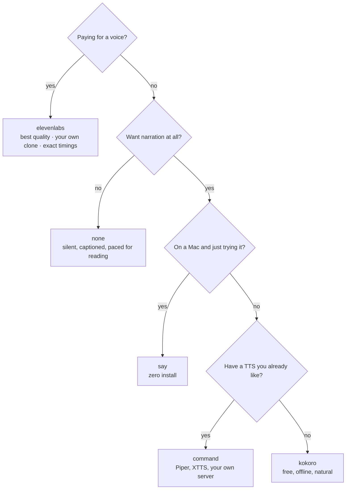

# Voices

Pick a provider in `posthouse.config.local.json` (create it; it's git-ignored and merged over
`posthouse.config.json`). A single video can override it in its `video/scenes.json` with
`"voice": { "provider": "…" }`, and a single run with `npm run voice -- --provider …`.

Check any setup with:

```bash
node bin/posthouse.mjs doctor
node bin/posthouse.mjs voices              # what voices this provider has
node bin/posthouse.mjs say "Testing, one two three."
```

## Which one?



| Provider | Quality | Cost | Runs | Licence of the output |
|---|---|---|---|---|
| `elevenlabs` | ★★★★★ | from ~$5/month | cloud | commercial use on paid plans; free tier needs attribution |
| `kokoro` | ★★★★ | free | your CPU | Apache-2.0 model |
| `command` + Piper | ★★★ | free | your CPU | depends on the voice you download |
| `say` | ★★ (★★★ with Premium voices) | free | macOS | personal, non-commercial |
| `none` | no voice | free | anywhere | yours |

## `say` (macOS)

Nothing to install. The default on a Mac.

```json
{ "voice": { "provider": "say", "say": { "voice": "Samantha", "rate": 180 } } }
```

Better voices are free: System Settings → Accessibility → Spoken Content → System voice → Manage Voices, then
download a **Premium** or **Enhanced** English voice and put its name in `voice`. `node bin/posthouse.mjs voices`
lists what's installed.

## `kokoro` (local, free)

A small open-weight model (82M parameters) that runs on CPU through [kokoro-js](https://www.npmjs.com/package/kokoro-js).

```bash
npm install --no-save kokoro-js     # at the repo root; the first run downloads the model (~90 MB)
```

```json
{ "voice": { "provider": "kokoro", "kokoro": { "voice": "af_heart", "speed": 1 } } }
```

Voices include `af_heart`, `af_bella`, `am_michael`, `bf_emma`, `bm_george` (a/b = American/British, f/m =
female/male). `node bin/posthouse.mjs voices --provider kokoro` lists them all.

## `command` (any local TTS)

Run any program that turns text into an audio file. Placeholders: `{out}` (the file to write), `{text}` (the text,
shell-quoted), `{textFile}` (a file holding the text). With `"input": "stdin"` (the default) the text is also piped
in.

**Piper** ([rhasspy/piper](https://github.com/rhasspy/piper) releases, plus a voice from its voice list):

```json
{
  "voice": {
    "provider": "command",
    "command": { "run": "piper --model ~/voices/en_US-lessac-medium.onnx --output_file {out}", "input": "stdin", "ext": "wav" }
  }
}
```

**Your own voice server** (anything with an HTTP endpoint):

```json
{ "voice": { "provider": "command", "command": { "run": "curl -s -X POST localhost:8000/tts --data-binary @{textFile} -o {out}", "input": "none" } } }
```

The command comes only from your config and runs as you.

## `elevenlabs` (hosted, paid)

The best quality, and the only provider that can speak in **your own cloned voice**. Returns exact word timings,
so whisper isn't needed.

1. Get a key: elevenlabs.io → Settings → API keys.
2. `cp .env.example .env` and paste it after `ELEVENLABS_API_KEY=`. (On macOS you can instead store it in the
   Keychain: `security add-generic-password -a "$USER" -s elevenlabs -w`. posthouse checks there too.)
3. Pick a voice: `node bin/posthouse.mjs voices --provider elevenlabs`, then:

```json
{
  "voice": {
    "provider": "elevenlabs",
    "elevenlabs": { "voiceId": "…", "voiceName": "My voice", "modelId": "eleven_multilingual_v2", "settings": { "stability": 0.6, "similarity_boost": 0.85 } }
  }
}
```

- `npm run voice -- --dry-run` shows the credit cost (about 1 credit per character; a 60 s video is ~900) and
  what's left, before spending anything. `node bin/posthouse.mjs usage` shows your balance.
- Each scene is sent with its neighbours' text (`previous_text` / `next_text`), so intonation flows across scenes.
- **Clone your voice:** ElevenLabs → Voices → Add voice → Instant Voice Clone (1–2 minutes of clean speech). Use
  the clone's ID as `voiceId`.
- More stable delivery: raise `stability` (0.6–0.75). Closer to the clone: raise `similarity_boost`.
- Audio tags like `[excited]` work on models that support them; posthouse strips them from captions.

## `none` (silent)

```json
{ "voice": { "provider": "none", "none": { "wordsPerSecond": 2.5 } } }
```

No audio. Each scene is held long enough to read its caption. Sounds (whoosh, tick, pop) still play.

## Word timings

Local voices return audio without timings. posthouse gets them from
[whisper.cpp](https://github.com/ggml-org/whisper.cpp) when it's installed, or estimates them from word length when
it isn't. Estimates work, but cues can land a beat early or late. Install whisper for exact timing:

```bash
# macOS
brew install whisper-cpp
mkdir -p models && curl -L -o models/ggml-base.en.bin \
  https://huggingface.co/ggerganov/whisper.cpp/resolve/main/ggml-base.en.bin
```

On Linux, build whisper.cpp from source (its README has a two-line build) and put `whisper-cli` on your PATH.

posthouse looks for a model in `align.model`, `$WHISPER_MODEL`, `./models/`, `~/.cache/whisper/` and Homebrew's
share folder. `base.en` (142 MB) is plenty; `small.en` is a little more exact. Set `"align": { "whisper": "off" }`
to always estimate.

## Adding a provider

One file in `lib/voice/` implementing the interface in [architecture.md](architecture.md#the-voice-layer), one line
in `lib/voice/index.mjs`, and a section here. Pull requests welcome.
